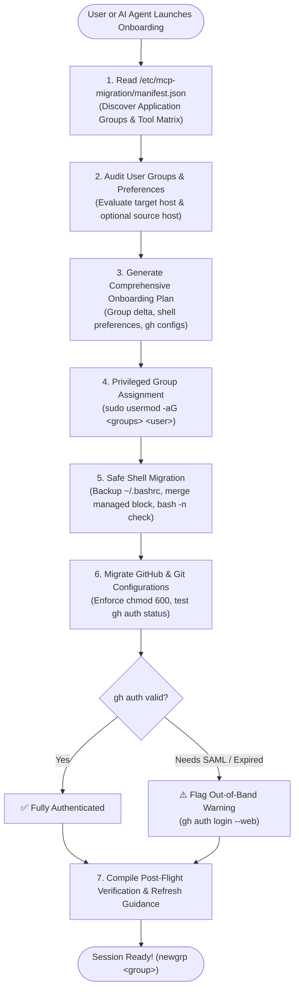

# 🚀 mcp-useronboard: Enterprise Linux User Onboarding MCP Agent & CLI

[](https://modelcontextprotocol.io/)
[](LICENSE)

An intelligent, enterprise-grade **Model Context Protocol (MCP)** agent and CLI designed for seamlessly onboarding users onto newly migrated or provisioned **Enterprise Linux** servers (RHEL, Rocky, AlmaLinux, Oracle Linux, Fedora).

`mcp-useronboard` consumes the **Onboarding Handover Contract** produced by [`mcp-servermigrate`](https://github.com/tommy-k/mcp-servermigrate), automatically aligning user roles to custom application groups, non-destructively preserving shell preferences, and validating developer credentials.

---

## 🌟 Key Capabilities

* 🤝 **Onboarding Handover Contract Consumer**
  * Directly reads `/etc/mcp-migration/manifest.json` and on-server operational skills (`SKILL.md`) left by `mcp-servermigrate`.
  * Dynamically maps role groups (e.g., `terraform_users`, `git_users`, `db_operators`) to controlled binaries in `/opt/tools/bin` without hardcoded assumptions.
* 👥 **Privileged Group & Role Assignment**
  * Inspects existing user groups on target and source hosts (`id -Gn <user>`).
  * Executes elevated group modifications (`sudo usermod -aG <group> <user>`) using safe, in-memory ephemeral credentials.
  * Solves Linux session cache invalidation by automatically providing actionable session refresh guidance (`newgrp <group>` or `exec su -l $USER`).
* 🐚 **Non-Destructive Shell & Dotfile Migration**
  * Safely migrates user aliases (`alias k=kubectl`), personal environment variables (`EDITOR`, `PAGER`), prompts (`PS1`, Starship), and completions.
  * Avoids clobbering system baselines and `/etc/profile.d/corp-standards.sh` tool paths.
  * **Safety Guardrails:** Always generates a timestamped backup (`~/.bashrc.pre-onboard.<timestamp>`), updates an idempotent managed block, and runs `bash -n` syntax verification before applying changes.
* 🔐 **GitHub CLI (`gh`) & Git Credential Handover**
  * Migrates `~/.config/gh/hosts.yml`, `~/.config/gh/config.yml`, and `~/.gitconfig` while enforcing strict POSIX permissions (`chmod 700 ~/.config/gh`, `chmod 600 hosts.yml`).
  * Runs real-time verification (`gh auth status` and `gh api user`).
  * **Graceful Failure Handling:** If corporate SAML SSO, IP restrictions, or token expiration blocks authentication, it flags a clear non-blocking advisory with exact login instructions (`gh auth login --hostname github.com --web`) to address on the side without halting the rest of onboarding.
* ⚡ **Dual Operational Modes**
  * **MCP Agent:** Direct integration with Cursor, Antigravity, or Claude Desktop via stdio.
  * **Interactive CLI:** Rich terminal interface with dry-run support, tables, and spinners.

---

## 🏗️ Architecture & Workflow



---

## 📥 Installation

Clone the repository and set up a virtual environment (Python 3.11+ required):

```bash
# 1. Clone repository
git clone https://github.com/tommy-k/mcp-useronboard.git
cd mcp-useronboard

# 2. Create and activate virtual environment
python3 -m venv .venv
source .venv/bin/activate

# 3. Install in editable mode
pip install --upgrade pip
pip install -e .
```

---

## 🚀 How to Run as an MCP Agent

`mcp-useronboard` provides native tools for AI assistants (Cursor, Antigravity, Claude Desktop):

### 1. Cursor / Antigravity Local MCP Configuration (`mcp_config.json` or `.cursor/mcp.json`)
```json
{
  "mcpServers": {
    "user-onboard": {
      "command": "<path-to-repo>/.venv/bin/python",
      "args": ["-m", "mcp_useronboard.server"]
    }
  }
}
```

### 2. Windows Host Bridging into WSL
```json
{
  "mcpServers": {
    "user-onboard": {
      "command": "wsl.exe",
      "args": [
        "-d", "FedoraLinux-44",
        "bash", "-c",
        "cd /home/tom/github-repos/mcp-useronboard && source .venv/bin/activate && python -m mcp_useronboard.server"
      ]
    }
  }
}
```

### 🛠️ Exposed MCP Tools

| Tool Name | Parameters | Description |
| :--- | :--- | :--- |
| `audit_onboarding_contract` | `target_host`, `username` | Inspects `/etc/mcp-migration/manifest.json` and audits role groups, tools, and current memberships. |
| `plan_onboarding` | `target_host`, `source_host`, `username`, `requested_tools`, `requested_groups` | Calculates group assignments, extracts shell preferences, and inspects GitHub CLI configurations. |
| `execute_onboarding` | `target_host`, `source_host`, `username`, `requested_tools`, `requested_groups`, `auto_approve_sudo` | Executes end-to-end onboarding: applies groups with sudo, merges dotfiles with backup & syntax check, migrates `gh`, and verifies access. |
| `verify_user_access` | `target_host`, `username` | Verifies group memberships, tool executability in `/opt/tools/bin`, bash syntax, and GitHub auth status. |

---

## 💻 CLI Usage Examples

You can also run `mcp-useronboard` directly from the command line:

### 1. Audit Target Server Contract
```bash
mcp-useronboard audit --target target-host.corp.local --user tom
```

### 2. Dry-Run Onboarding Plan
```bash
mcp-useronboard onboard --target target-host.corp.local --tools "terraform,gh" --dry-run
```

### 3. End-to-End Onboarding Execution
```bash
# Onboards user 'tom' to target host, syncing dotfiles from source server
mcp-useronboard onboard \
  --target target-host.corp.local \
  --source source-host.corp.local \
  --user tom \
  --tools "terraform,gh" \
  --auto-approve-sudo
```

---

## 🧪 Testing

Run the automated pytest suite:

```bash
source .venv/bin/activate
pytest tests/ -v
```

---

## 📄 License

This project is licensed under the MIT License - see the [LICENSE](LICENSE) file for details.
