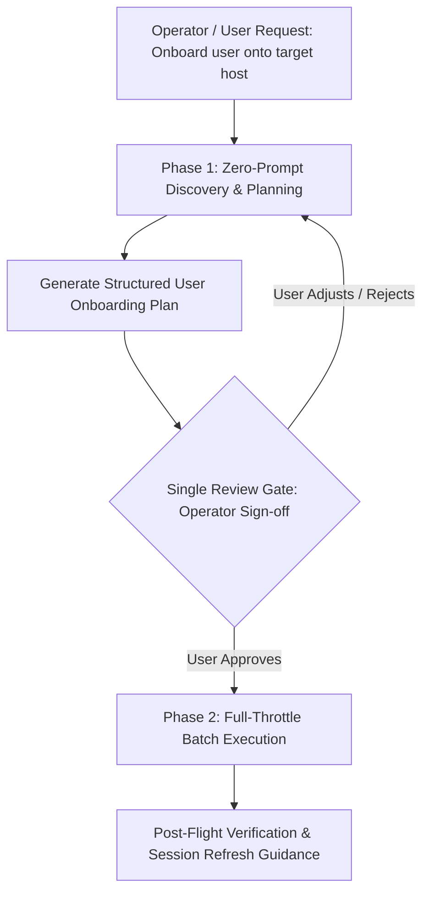

# Autonomous User Onboarding Protocol (Plan-Then-Batch)

This protocol governs AI coding and onboarding agents (Cursor, Antigravity, Claude Desktop, Windsurf, VS Code) when onboarding users onto Enterprise Linux servers using `mcp-useronboard`. It eliminates approval fatigue through a structured Two-Phase Execution Contract.

---

## 🏛️ The Two-Phase Execution Contract



---

## Phase 1: Zero-Prompt Discovery & Planning

When tasked with onboarding a user:
1. **Auto-Approve All Read Operations:** Execute audit and planning tools (`audit_onboarding_contract`, `plan_onboarding`) automatically without asking the user for confirmation per step.
2. **Compile the Onboarding Plan:** Synthesize the onboarding delta into a structured Markdown Plan:
   - Target user & host.
   - Application role groups to assign (and tools unlocked by those groups based on `/etc/mcp-migration/manifest.json`).
   - Shell preferences to migrate (`~/.bashrc` aliases, exports, prompt customization).
   - GitHub CLI (`~/.config/gh`) and Git credential status.
3. **The Single Review Gate:** Present the plan clearly and halt for a **single operator sign-off**:
   > **Review Checkpoint:** *"User Onboarding Plan compiled above. Do you approve proceeding with automated execution?"*

---

## Phase 2: Full-Throttle Batch Execution

Once the operator approves the plan:
1. **Uninterrupted Execution:** Do **NOT** prompt the user between routine steps. Proceed autonomously through:
   - Creating any missing groups and assigning the user (`usermod -aG`).
   - Backing up `~/.bashrc` to `~/.bashrc.pre-onboard.<timestamp>`.
   - Merging shell preferences in an idempotent managed block and verifying syntax (`bash -n`).
   - Transferring `~/.config/gh` and `~/.gitconfig` with strict `0600`/`0700` permissions.
   - Running post-onboarding verification.
2. **Non-Interactive Sudo & Credentials:**
   - Execute with `--auto-approve-sudo` / `ONBOARDING_AUTO_APPROVE=1` / `MIGRATION_AUTO_APPROVE=1`.
   - Supply sudo credentials via `--sudo-pass-file` / `ONBOARDING_SUDO_PASS_FILE` (must be mode `0600` or `0400`) or `ONBOARDING_SUDO_PASS`.
   - Avoid interactive terminal password prompts.

---

## 🛑 Strict Safety Guardrails (Exceptions)

Explicit confirmation is strictly required **ONLY** if:
- Destructive commands target paths outside `/tmp/`, `~/.bashrc`, or `~/.config/gh/`.
- Removing user accounts or modifying system-wide `/etc/sudoers`.
- Modifying host network adapters, firewalls, or issuing system reboots.
- Unrecoverable command failures require operator escalation.

---

## ⚡ Where Approval Fatigue is Eliminated

| Problem Area | How `mcp-useronboard` Simplifies It |
| :--- | :--- |
| **IDE Tool Dialog Storms** | Pre-authorizes MCP tools via `"alwaysAllow"` or uses the all-in-one `auto_onboard` tool. |
| **Interactive Sudo Prompts** | Supports mode `0600` password files (`--sudo-pass-file`) and headless MCP auto-approval. |
| **Chatty Group Assignments** | Batches group existence checks and `usermod -aG` into compound privileged commands. |
| **Active Directory Group Errors** | Uses trailing colon syntax `chown user:` to automatically inherit primary domain groups. |
| **Broken Shell Anxiety** | Automatically tests new configurations with `bash -n` on a staging file before replacing `~/.bashrc`. |
| **GitHub SSO Token Expiration** | Emits clean, non-blocking advisories with exact login instructions without halting onboarding. |

---

## ⚙️ Client Configuration Setup (Client-Agnostic)

Use the following configuration snippets to register `mcp-useronboard` with your preferred AI client. Replace `/path/to/mcp-useronboard` with your local repository path.

### 1. Cursor IDE (`.cursor/mcp.json`)
Pre-authorizes tools to eliminate tool approval popups:
```json
{
  "mcpServers": {
    "user-onboard": {
      "command": "/path/to/mcp-useronboard/.venv/bin/mcp-useronboard",
      "args": ["serve", "--transport", "stdio"],
      "alwaysAllow": [
        "audit_onboarding_contract",
        "plan_onboarding",
        "execute_onboarding",
        "verify_user_access",
        "auto_onboard"
      ]
    }
  }
}
```

### 2. Claude Desktop
Add to `claude_desktop_config.json`:
```json
{
  "mcpServers": {
    "user-onboard": {
      "command": "/path/to/mcp-useronboard/.venv/bin/python",
      "args": ["-m", "mcp_useronboard.server"]
    }
  }
}
```

### 3. Google Antigravity / Gemini CLI (`mcp_config.json`)
```json
{
  "mcpServers": {
    "user-onboard": {
      "command": "/path/to/mcp-useronboard/.venv/bin/python",
      "args": ["-m", "mcp_useronboard.server"]
    }
  }
}
```

### 4. Windsurf (Codeium Cascade) & VS Code (Cline / Continue)
```json
{
  "mcpServers": {
    "user-onboard": {
      "command": "/path/to/mcp-useronboard/.venv/bin/python",
      "args": ["-m", "mcp_useronboard.server"]
    }
  }
}
```
